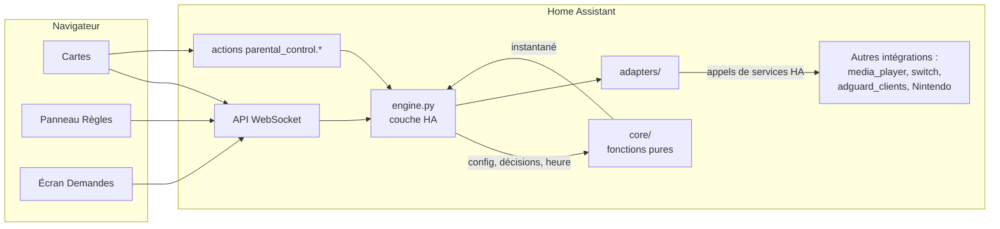
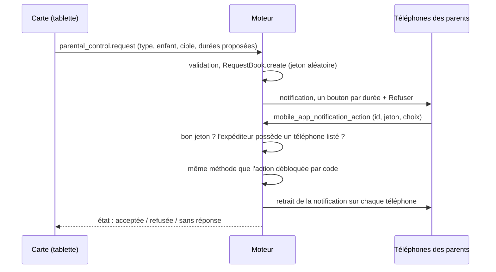

# Architecture

[English](architecture.md) · **Français**

Ce document décrit comment l'intégration `parental_control` est construite, et pourquoi. Pour
l'installation et l'usage au quotidien, voir le [README](../README.fr.md).

Sommaire :

1. [Vue d'ensemble](#1-vue-densemble)
2. [Organisation du code](#2-organisation-du-code)
3. [Modèle](#3-modèle)
4. [Évaluation : le noyau pur](#4-évaluation--le-noyau-pur)
5. [La boucle du moteur](#5-la-boucle-du-moteur)
6. [Adaptateurs et correction des dérives](#6-adaptateurs-et-correction-des-dérives)
7. [Sécurité](#7-sécurité)
8. [Demandes de temps](#8-demandes-de-temps)
9. [Simulation](#9-simulation)
10. [Persistance](#10-persistance)
11. [API WebSocket et actions](#11-api-websocket-et-actions)
12. [Internationalisation](#12-internationalisation)
13. [Tests](#13-tests)

## 1. Vue d'ensemble

L'intégration a trois pièces, livrées ensemble dans `custom_components/parental_control/` :

1. **le moteur** (Python) : décide, pour chaque enfant et chaque appareil, si l'accès est
   ouvert, pourquoi, jusqu'à quand et combien de temps il reste, puis applique cette décision ;
2. **les cartes du tableau de bord** (JavaScript) : affichent l'état du moteur et appellent ses
   actions ;
3. **le panneau « Règles »** (JavaScript) : modifie la configuration sans écrire de JSON. Un
   quatrième écran, plus petit, **« Demandes »**, permet aux parents de répondre aux demandes de
   temps des enfants.



**Pourquoi une seule intégration pour les trois pièces.** Les cartes et le panneau sont servis
par l'intégration elle-même (chemin statique, `add_extra_js_url` et `panel_custom`). Ils sont
toujours à la version du moteur : pas de dépôt frontend séparé à installer et à tenir à jour.
L'URL des fichiers servis contient une empreinte de leur contenu : un navigateur ne peut pas
garder une ancienne carte après une mise à jour.

**Pourquoi du JavaScript sans compilation.** Des web components natifs, sans étape de
construction : les fichiers de `www/` sont ceux que charge le navigateur, et leurs parties
pures se testent directement avec `node --test`.

**Pourquoi tout passe par Home Assistant.** Le moteur ne parle jamais directement à AdGuard
Home, à un téléviseur ou à Nintendo. Il lit seulement des entités HA et appelle les services HA
des intégrations qui connaissent déjà ces appareils (`media_player.turn_off`,
`adguard_clients.set_blocked_services`, l'action de bonus de l'intégration Nintendo…). Chaque
appareil garde un seul responsable de son protocole, de ses identifiants et de ses
particularités, et tout ce que HA sait commander peut être piloté.

## 2. Organisation du code

| Chemin | Rôle |
|---|---|
| `core/` | Python pur, sans import de `homeassistant` : modèle, lecture de la configuration, type de journée, décisions, évaluateur, données d'affichage, cycle de vie des demandes, textes du serveur. |
| `engine.py` | Relie le noyau à HA : minuteries, écoutes, boucle d'évaluation, application, avertissements, notifications, demandes. |
| `adapters/` | Un adaptateur par type d'intégration, un composite par appareil logique, une enveloppe de simulation. |
| `label_switches.py` | Retrouve les interrupteurs pilotés par label dans les registres des entités et des labels. |
| `security.py`, `parents.py` | Code parent (hachage, vérification, verrouillage) et « qui est parent ». |
| `request_listener.py` | Réponses aux demandes de temps venues des notifications mobiles. |
| `services.py`, `services.yaml` | Les actions `parental_control.*`. |
| `websocket.py`, `serialize.py` | Commandes WebSocket et forme JSON de l'état. |
| `sensor.py`, `binary_sensor.py`, `button.py`, `switch.py`, `entity.py` | Entités HA, créées et retirées au fil des changements de configuration. |
| `store.py` | Persistance de la configuration et des décisions. |
| `config_flow.py` | Fenêtres d'installation et d'options : le code parent, stocké haché. |
| `calendar_source.py` | Lit les événements « journée entière » des calendriers des enfants. |
| `catalog.py` | Le catalogue des services AdGuard Home, pour rattacher des services dans le panneau. |
| `const.py` | Constantes partagées (domaine, noms d'événement et de signal, battement). |
| `frontend.py` | Sert `www/`, charge les cartes, enregistre les panneaux « Règles » et « Demandes ». |
| `texts.py` | Textes du serveur dans la langue système de HA. |
| `translations/`, `strings.json` | Métadonnées HA (actions, entités, configuration, erreurs) en `en` et `fr`. |
| `www/` | Cartes, panneau, écran « Demandes » ; `lib.js`, `panel-lib.js`, `editor-lib.js` et `i18n.js` portent la logique sans DOM ; `i18n/<langue>.js` sont les catalogues de l'interface. |

## 3. Modèle

### Enfants, frises et types de journée

Un **enfant** a un **profil par type de journée** : `school` (école), `weekend` (fin de
semaine), `day_off` (congé pédagogique), `holidays` (vacances). `school` et `weekend` sont
obligatoires ; un profil `day_off` ou `holidays` absent se rabat sur `weekend`. Un profil est
une **frise** : des segments qui couvrent 00:00 à 24:00, chacun avec un type.

| Segment | Comportement |
|---|---|
| `blocked` | fermé |
| `free` | ouvert |
| `after_homework` | fermé jusqu'à ce qu'un parent valide les devoirs, puis ouvert jusqu'à la fin du segment |
| `quota` | ouvert tant que dure le budget du jour, fermé à la fin du segment |
| `on_demand` | fermé sauf si un parent l'ouvre |

Le type de journée vient du calendrier scolaire de l'enfant : un événement **sur la journée
entière** dont le titre contient un mot de `calendar_map` fixe le type (les vacances
l'emportent sur un congé, qui l'emporte sur le défaut du jour de semaine). Sans événement
reconnu, du lundi au vendredi c'est `school`, la fin de semaine `weekend`.

**Pourquoi une frise par type de journée.** La journée d'une famille est une suite (après
l'école, devoirs, souper, nuit) qui se répète avec quelques variantes. La décrire une fois par
sorte de journée et laisser le calendrier choisir la variante fait d'un changement d'horaire
une modification de la frise, jamais une nouvelle automatisation. Chaque enfant a son propre
calendrier, car les écoles n'ont pas les mêmes congés.

**Pourquoi des modes par appareil plutôt que plusieurs frises.** Les `resource_modes` d'un
enfant peuvent fixer un appareil pour toute la journée (`on_demand`, `blocked`, `free`) pendant
que les autres suivent la frise (`schedule`, par défaut). Une console toujours sur demande n'a
pas besoin d'une frise à elle.

### Appareils logiques

```
appareil logique (« Télé »)            règles : enfants, quota par type de journée, mode par enfant
├── appareil physique (« Télé salon »)  une étiquette pour ranger, sans règle
│   ├── intégration : media_player
│   └── intégration : adguard_services
└── appareil physique (« Google TV »)
    ├── intégration : media_player
    └── intégration : adguard_services
```

Dans le code, l'appareil logique est la `Resource` (son `id` est stable : exceptions, usage,
modes et entités HA s'y rattachent). Son comportement se déduit de **ce qu'il contient**
(`Resource.has(kind)`), pas d'un type : un appareil avec un lecteur multimédia a son propre
compteur d'usage et son quota ; un appareil avec un client AdGuard bloque des services ; les
deux à la fois font les deux. Une console Nintendo doit être seule dans son appareil logique :
elle se pilote par bonus et compte son temps elle-même, la mélanger à autre chose n'aurait pas
de sens.

**Pourquoi un appareil logique plutôt que des entités brutes.** Pour la famille, « la Télé »
est une seule chose, même quand c'est un téléviseur, une clé de diffusion et trois clients DNS.
Les règles se posent une fois, sur l'appareil logique ; chaque intégration en dessous applique
la même décision à sa façon. Les cartes montrent une Télé, pas cinq entités.

### Services et labels de cible

Un **service** est défini par le parent (nom, icône) et liste ce qui le bloque réellement : des
identifiants de services AdGuard Home et/ou des labels HA posés sur des `switch` (une règle de
pare-feu, par exemple). Listes de loisirs, listes sur demande, exceptions, demandes et cartes ne
connaissent que ces services.

Un **label de cible** est un label HA associé à un enfant ou à un appareil logique. Un
interrupteur qui porte un label rattaché à un service et un label de cible est piloté pour
cette cible : il est « bloqué » quand le service doit l'être pour la cible.

**Pourquoi des services définis par le parent plutôt que le catalogue AdGuard.** Le catalogue
AdGuard est long et lié à un seul moyen de blocage. Un parent pense « jeux vidéo », pas
« roblox, fortnite, steam ». Un service regroupe ce qui le bloque : bloquer « jeux vidéo »
bloque d'un coup les entrées DNS et la règle de pare-feu, et un nouveau moyen de blocage est
une sorte de rattachement de plus, pas une nouvelle liste.

**Pourquoi des labels.** Ils permettent de piloter n'importe quel interrupteur HA sans
intégration dédiée et sans convention de nommage : rien ne se passe tant que le parent n'a pas
rattaché le label dans le panneau.

## 4. Évaluation : le noyau pur

Tout ce qui décide vit dans `core/`, sous forme de fonctions de leurs entrées :

```
evaluate(now, config, decisions, day_types) -> Snapshot
```

- `config` (`core/model.py`) : enfants, profils, ressources, services.
- `decisions` (`core/decisions.py`) : ce que les parents ont décidé (devoirs terminés, bonus,
  exceptions, minuteurs, pause, simulation) et l'usage compté par appareil et par jour.
- `day_types` : le type de journée de chaque enfant, calculé à partir des événements du
  calendrier par `core/daytype.py`.

`evaluate` procède dans cet ordre :

1. état de chaque enfant d'après sa frise (statut, fin de plage, temps restant) ;
2. accès de chaque couple (enfant, appareil), puis état « règle seule » de chaque appareil ; un
   appareil partagé est ouvert dès qu'un de ses enfants y a droit ;
3. les exceptions « jusqu'au prochain changement de règle » dont l'état de la règle a changé
   depuis leur création échoient (chaque exception garde une signature de cet état) ;
4. les exceptions manuelles restantes s'appliquent : d'abord celles d'appareil, puis celles de
   service, la plus récente l'emportant ; fermer un appareil l'emporte sur les exceptions de
   service plus anciennes qui le visent ;
5. la pause générale l'emporte sur tout.

L'instantané (`Snapshot`) contient, par enfant et par appareil, l'état et sa **raison** sous
forme d'un code et de paramètres (`reason_code`, `reason_params`), jamais d'une phrase.
`upcoming_closures` projette l'usage en cours pour savoir ce qui fermera et quand, pour les
avertissements. `core/display.py` calcule la frise du jour et la fin de chaque exception pour
les cartes : les cartes ne recalculent jamais une règle.

**Quota.** Un appareil avec un lecteur multimédia ou un interrupteur mesure son propre usage :
son budget est son `quota_minutes` pour le type de journée, ou à défaut le quota de temps
d'écran le plus généreux de ses enfants (il est partagé, et personne ne sait qui regarde). Un
appareil qui ne sait pas mesurer (un client AdGuard, la console) ne s'ouvre que pendant un
minuteur lancé par un parent, et le minuteur puise dans le budget de l'enfant.

**Pourquoi un noyau pur.** Les règles sont la partie la plus susceptible d'être fausse et la
plus difficile à tester dans un HA en marche. En fonctions simples de
`(heure, configuration, décisions)`, elles se testent par centaines sans HA, à n'importe quel
instant de n'importe quel jour, minuit, recoupements et appareils partagés compris. La couche
HA ne fait que rassembler les entrées et appliquer les sorties.

## 5. La boucle du moteur

`engine.py` appelle `evaluate` et agit sur le résultat. Une évaluation est déclenchée par :

- un battement d'une minute (quotas, changements de segment) ;
- un changement d'état d'une entité pilotée (usage, dérive) ;
- un rafraîchissement des calendriers (toutes les 15 minutes et juste après minuit) ;
- un changement du registre des entités ou des labels (interrupteurs labellisés) ;
- toute décision d'un parent (action, carte, réponse à une demande) ou changement de
  configuration.

Chaque évaluation se fait sous verrou :

1. ajouter le temps écoulé aux appareils en usage (plafonné à 5 minutes, pour qu'un long arrêt
   de HA ne compte pas comme du temps d'écran) ;
2. purger les décisions échues ;
3. évaluer, puis retirer les exceptions « jusqu'au prochain changement » échues ;
4. appliquer chaque appareil dont l'état voulu a changé, ou qui a dérivé ;
5. avertir avant les fermetures prévisibles (événement `parental_control_warning`, services
   `notify` des parents, l'appareil lui-même s'il sait afficher un message) ;
6. enregistrer les décisions (écriture différée) et prévenir les entités et les abonnés
   WebSocket.

**Pourquoi n'appliquer qu'au changement.** Les commandes partent quand l'état voulu change, pas
chaque minute : pas de rafale d'appels, et un appareil ouvert est laissé tranquille.

## 6. Adaptateurs et correction des dérives

Un adaptateur traduit un `ResourceState` voulu en appels de services HA, pour une intégration :

| Adaptateur | Lit | Écrit |
|---|---|---|
| `media_player` | état allumé/éteint (usage) | `media_player.turn_off` ; message facultatif à l'écran |
| `switch` | état allumé/éteint (usage) | coupé ; rallumé une fois à l'autorisation, en option |
| `adguard_services` | le capteur des services bloqués du client | `adguard_clients.set_blocked_services` |
| `nintendo` | les entités limite, restant et utilisé de l'intégration | temps bonus ; la limite du jour reste à 0 |

Le moteur ne les voit pas directement. Chaque appareil logique a un **adaptateur composite** qui
transmet chaque appel à tous ses membres, **un par un** : un membre absent ou en échec (une clé
de diffusion débranchée) est journalisé et n'empêche pas les autres. Une **enveloppe de
simulation** entoure chaque composite (voir [Simulation](#9-simulation)). Les interrupteurs
labellisés ne font pas partie de l'arbre des appareils : le moteur les trouve dans les
registres et les pilote directement d'après l'état du service (`core/label_services.py`).

**Pourquoi un adaptateur par intégration.** Ajouter une sorte d'appareil (un pare-feu, une
prise connectée) revient à écrire un adaptateur, sans toucher au moteur ni aux règles.

**Le moteur fait foi tant que c'est fermé.** Si l'état réel contredit un état voulu fermé (télé
rallumée à la télécommande, service AdGuard débloqué ailleurs, limite Nintendo relevée),
l'adaptateur signale une **dérive** et le moteur la corrige, au plus une fois par 30 secondes
pour laisser à l'appareil le temps de rapporter son nouvel état. Quand l'état voulu est ouvert,
rien n'est forcé : le moteur ferme, il n'allume pas. Les décisions des parents passent par les
actions du moteur, jamais par les entités brutes.

## 7. Sécurité

### Qui est parent

Un parent est un **administrateur** HA, ou le **propriétaire mémorisé d'un téléphone** de
`request_notify` (les téléphones des parents pour les demandes). Il n'y a pas de liste de
parents à part. La règle vit dans une seule fonction (`parents.is_parent`), pour pouvoir être
remplacée plus tard par les groupes d'utilisateurs HA sans toucher aux appelants. Elle est
évaluée à chaque appel, sur la configuration courante : retirer un téléphone retire le droit
aussitôt.

Le nom `notify.mobile_app_<x>` vient d'un nom d'appareil que tout utilisateur peut choisir. Le
propriétaire de chaque téléphone est donc **déterminé par le serveur** à l'enregistrement ou à
l'import de la configuration, d'après les entrées `mobile_app`, et mémorisé avec la
configuration (`request_notify_owners`) ; une valeur envoyée par un client est ignorée. Un
téléphone ne donne de droits que tant que son propriétaire actuel est le propriétaire mémorisé
et que le nom n'est pas ambigu.

### Le code parent

Les actions qui **ouvrent** (autoriser, bonus, devoirs terminés, minuteur, levée de la pause,
activation de la simulation) exigent le code parent d'un utilisateur non parent. Les actions
qui ferment ne l'exigent jamais. Un appel sans utilisateur (automatisation, script) est
considéré comme fiable, comme ailleurs dans HA.

- Le code est stocké haché (PBKDF2-SHA256 salé), jamais en clair, jamais dans une carte ni un
  tableau de bord : la carte le demande au moment d'agir et l'oublie.
- Après 5 codes faux de suite, les essais sont refusés 60 s, durée doublée jusqu'à 15 minutes,
  par utilisateur.
- Chaque contrôle se fait **côté serveur** (actions, commandes WebSocket). Les cartes ne
  cachent des boutons que pour le confort : la commande `whoami` leur dit si l'utilisateur est
  parent, et tant qu'elle n'a pas répondu elles se comportent comme pour un non-parent.
- La configuration (identifiants d'appareils, cibles de notification) n'est envoyée qu'aux
  parents. Les cartes lisent un état d'affichage qui ne contient ni le code ni les calendriers.

### Échec côté fermé

Dans le doute, le moteur garde fermé plutôt qu'ouvert : une ouverture à tort est pire qu'une
fermeture à tort, puisqu'un parent peut toujours rouvrir. Concrètement :

- une configuration enregistrée invalide laisse le moteur inactif et affiche une notification
  persistante ; il ne rouvre rien, et les décisions sont gardées pour quand elle sera corrigée ;
- un téléphone dont le propriétaire est inconnu, ambigu ou a changé ne donne aucun droit et ne
  peut pas répondre à une demande ;
- une carte qui ne sait pas encore si l'utilisateur est parent demande le code ;
- un service bloqué par une exception hors des listes de loisirs reste bloqué après un
  redémarrage, jusqu'à ce qu'un parent le débloque ;
- une demande n'est accordée que par la réponse d'un parent : l'envoyer n'ouvre rien, et une
  réponse à une demande expirée, inconnue ou déjà traitée est sans effet.

## 8. Demandes de temps

Un enfant peut **demander** au lieu de taper le code. La demande part vers les téléphones des
parents sous forme de notification actionnable ; la première réponse valable applique l'action.



- Une demande est vérifiée à l'envoi (cible inconnue, appareil qui n'est pas à l'enfant…), pas
  à la réponse du parent.
- Une seule demande en attente par enfant, action et cible ; trois au plus en attente par
  enfant ; sans réponse après 15 minutes, elle expire ; le résultat reste visible 5 minutes.
- Une réponse n'est acceptée que si elle porte le jeton aléatoire de la demande **et** vient du
  propriétaire mémorisé d'un téléphone listé (le webhook de l'application mobile émet
  l'événement avec le contexte de l'utilisateur enregistré). Être administrateur ne suffit pas.
  L'écran « Demandes » applique la même règle par `requests/answer`.
- Une demande acceptée appelle exactement la même méthode du moteur que l'action débloquée par
  code : mêmes vérifications, même comportement en simulation.
- Les demandes vivent seulement en mémoire : un redémarrage les oublie et une réponse tardive
  est ignorée. L'état publié contient les demandes et leurs résultats, jamais les jetons.

**Pourquoi les demandes en alternative au code.** Un enfant devant une tablette murale partagée
ne devrait pas avoir besoin d'un parent sur place pour chaque déblocage, et un parent ne
devrait pas avoir à partager le code. Un geste pour l'enfant, un geste pour le parent, où qu'il
soit ; le code reste utilisable par un parent devant la tablette.

## 9. Simulation

En simulation, le moteur décide comme d'habitude (états, frises, exceptions, avertissements,
usage), mais aucun appel d'adaptateur n'atteint un appareil. L'enveloppe de simulation remplace
`apply`, `warn`, `grant` et `force_close` par la description de ce qui se serait passé,
inscrite dans le journal de bord de HA, une fois par changement (une dérive persistante ne
remplit pas le journal). Les notifications aux parents partent quand même, préfixées, pour
pouvoir vérifier aussi les alertes. Quitter la simulation déclenche une resynchronisation
complète, comme au démarrage.

Une **nouvelle installation démarre en simulation** : on peut construire et observer les règles
avant qu'elles agissent. Comme la simulation relâche tous les appareils, l'activer exige le code
parent d'un non-parent.

**Pourquoi une seule enveloppe.** Une seule garde autour du composite couvre tous les
adaptateurs, présents et futurs : aucune sorte d'appareil ne peut être oubliée.

## 10. Persistance

Deux stockages HA :

| Stockage | Contenu | Écrit |
|---|---|---|
| `parental_control.config` | la configuration (`version: 3`) et les propriétaires mémorisés des téléphones | à l'enregistrement ou à l'import |
| `parental_control.state` | les décisions : devoirs, bonus, exceptions, minuteurs, pause, simulation, usage par appareil et par jour | après chaque évaluation, différé d'1 s pour regrouper les rafales ; immédiatement au déchargement |

Les devoirs et les bonus expirent à minuit ; une exception avec une durée court jusqu'à son
terme, même après minuit. Quand une configuration retire un enfant ou un appareil, les
décisions qui les visaient sont supprimées. Les demandes, le compteur de verrouillage du code
et le dernier état appliqué ne sont qu'en mémoire ; après un redémarrage, le moteur réapplique
l'état voulu à chaque appareil.

**Pourquoi la validation dans le noyau.** `core/config_io.py` valide toute configuration, quelle
que soit sa source (stockage, panneau, action d'import), et signale le chemin fautif avec un
code d'erreur. Le panneau garde un brouillon et ne l'envoie qu'à l'enregistrement ; le moteur
reste seul juge de la validité.

## 11. API WebSocket et actions

| Commande WebSocket | Qui | Rôle |
|---|---|---|
| `parental_control/whoami` | tous | indicateurs administrateur et parent de l'utilisateur de la connexion |
| `parental_control/config/get` | parents | la configuration et le statut de chaque téléphone |
| `parental_control/config/set` | parents | valider et enregistrer une configuration |
| `parental_control/services/catalog` | parents | le catalogue AdGuard, pour rattacher des services |
| `parental_control/labels/list` | parents | les labels HA, pour les services et les cibles |
| `parental_control/label_switches/list` | parents | interrupteurs pilotés et ignorés, avec la raison |
| `parental_control/state` | tous | l'état d'affichage, une fois |
| `parental_control/state/subscribe` | tous | l'état d'affichage, poussé à chaque changement |
| `parental_control/requests/subscribe` | tous | demandes en attente et récentes, avec « peut répondre » pour cet utilisateur |
| `parental_control/requests/answer` | propriétaires d'un téléphone listé | répondre à une demande depuis l'écran « Demandes » |

Les actions (`homework_done`, `add_bonus`, `exception`, `cancel_exception`, `start_timer`,
`stop_timer`, `pause`, `import_config`, `request`) sont décrites dans le
[README](../README.fr.md#actions). Les cartes n'utilisent que ces actions et l'abonnement :
elles n'appellent jamais elles-mêmes AdGuard, un lecteur multimédia ou Nintendo, ce qui
contredirait la correction des dérives du moteur. Les cartes partagent un seul abonnement à
l'état par connexion HA (`connection.js`).

## 12. Internationalisation

L'interface est en anglais et en français ; l'anglais est la langue par défaut et de repli. Les
textes se rangent en trois couches, chacune dans la langue de celui qui la lit :

| Couche | Langue | Où |
|---|---|---|
| Cartes, panneau « Règles », écran « Demandes » | celle du profil de l'utilisateur HA : `hass.locale.language`, sinon `hass.language` | `www/i18n/<langue>.js`, lus par `www/i18n.js` |
| Textes produits sans utilisateur : notifications et leurs boutons, avertissements de fermeture, préfixe de simulation, journal de bord, notification persistante, titre de la barre latérale | la langue système de HA, `hass.config.language` | `MESSAGES` de `core/i18n.py`, via `texts.py` |
| Métadonnées HA : actions et champs, entités et états, configuration, erreurs des actions, nom de l'appareil global | choisie par HA (le nom de l'appareil dans la langue système, à sa création) | `translations/<langue>.json` (`translation_key`), `strings.json` (= anglais) |

Une langue régionale (`fr-CA`, `en-GB`) se ramène à sa langue de base ; une langue sans
catalogue se rabat sur l'anglais. Heures, durées et pourcentages passent par `Intl`, avec le
choix 12 h / 24 h de l'utilisateur.

**Des données neutres.** Les identifiants (actions, types de journée, types de segment, modes,
statuts) sont des mots anglais dans toutes les langues. Le moteur ne stocke jamais de phrase :
une raison est un `reason_code` et des `reason_params` que chaque carte rend dans la langue de
son utilisateur (l'attribut `reason` du capteur de statut est rendu dans la langue système).
Une erreur de configuration porte un code, des paramètres et le chemin fautif : le panneau la
traduit, les actions la lèvent avec une `translation_key` HA, et le message anglais reste pour
les journaux. Les échecs de demande sont aussi des codes.

**Identifiants d'entités.** HA construit les identifiants d'entités à partir des noms traduits,
à la création de l'entité : une nouvelle installation sur un système en anglais obtient des
identifiants anglais (`switch.parental_control_global_pause`), sur un système en français des
identifiants français. Les identifiants d'entités existants ne changent jamais.

**Pourquoi trois couches.** Une notification se lit sur le téléphone d'un parent, sans session
de navigateur derrière : elle ne peut suivre que la langue système. Une carte est lue par un
utilisateur et suit son profil. HA traduit déjà ses propres métadonnées. Chaque couche utilise
le mécanisme qui connaît son lecteur.

**Ajouter une langue** revient à ajouter des catalogues, pas de la logique : `www/i18n/<langue>.js`
(déclaré dans `CATALOGUES` de `www/i18n.js`), une entrée `<langue>` dans `MESSAGES` de
`core/i18n.py`, et `translations/<langue>.json`. Des tests de parité vérifient que les
catalogues `en` et `fr` ont exactement les mêmes clés, en JavaScript, en Python et dans les
traductions JSON ; ils s'étendent à chaque nouvelle langue. Un autre test vérifie qu'aucun texte
français n'est codé en dur dans `www/` hors du catalogue français.

## 13. Tests

- `pytest` : `tests/core/` teste le noyau pur sans HA (évaluation à des instants donnés, lecture
  de la configuration, demandes, textes) ; `tests/ha/` fait tourner la couche HA avec
  `pytest-homeassistant-custom-component` (moteur, adaptateurs, entités, actions, WebSocket,
  parents, frontend).
- `node --test tests/js/*.test.mjs` : le JavaScript sans DOM (`lib.js`, `panel-lib.js`,
  `editor-lib.js`, `i18n.js`, `connection.js`, `style.js`) et les contrôles d'internationalisation.

Les deux suites tournent en intégration continue (`.github/workflows/tests.yml`).
