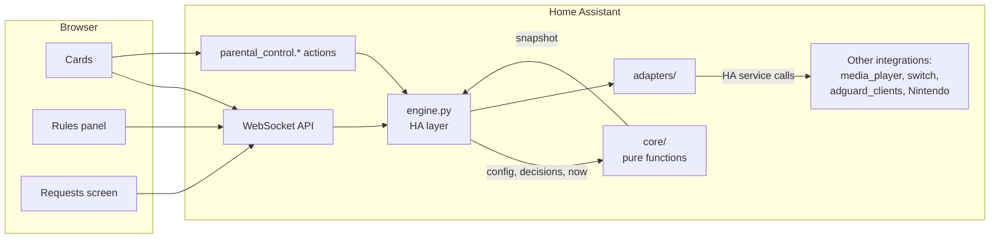
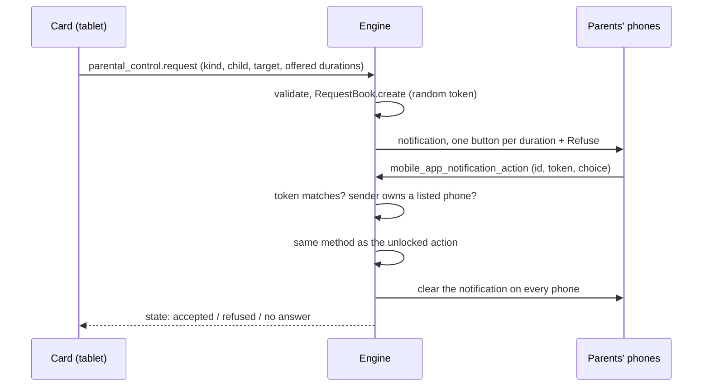

# Architecture

**English** · [Français](architecture.fr.md)

This document describes how the `parental_control` integration is built and why. For
installation and day-to-day use, see the [README](../README.md).

Contents:

1. [Overview](#1-overview)
2. [Code layout](#2-code-layout)
3. [Model](#3-model)
4. [Evaluation: the pure core](#4-evaluation-the-pure-core)
5. [The engine loop](#5-the-engine-loop)
6. [Adapters and drift correction](#6-adapters-and-drift-correction)
7. [Security](#7-security)
8. [Time requests](#8-time-requests)
9. [Simulation](#9-simulation)
10. [Persistence](#10-persistence)
11. [WebSocket API and actions](#11-websocket-api-and-actions)
12. [Internationalisation](#12-internationalisation)
13. [Tests](#13-tests)

## 1. Overview

The integration has three pieces, shipped together in `custom_components/parental_control/`:

1. **the engine** (Python): decides, for every child and every device, whether access is
   open, why, until when and how much time is left, then applies that decision;
2. **the dashboard cards** (JavaScript): show the engine's state and call its actions;
3. **the Rules panel** (JavaScript): edits the configuration without writing JSON. A fourth,
   smaller screen, **Requests**, lets parents answer the children's time requests.



**Why one integration for all three pieces.** The cards and the panel are served by the
integration itself (static path plus `add_extra_js_url` and `panel_custom`). They are always
at the engine's version: no separate frontend repository to install and keep in step. The URL
of the served files contains a hash of their content, so a browser cannot keep an old card
after an update.

**Why plain JavaScript.** Native web components with no build step: the files in `www/` are
the files the browser loads, and the pure parts are tested directly with `node --test`.

**Why everything goes through Home Assistant.** The engine never talks to AdGuard Home, a TV
or Nintendo directly. It only reads HA entities and calls HA services of the integrations
that already know these devices (`media_player.turn_off`,
`adguard_clients.set_blocked_services`, the Nintendo integration's bonus action…). Each device
keeps a single owner of its protocol, credentials and quirks, and anything HA can switch can be
controlled.

## 2. Code layout

| Path | Role |
|---|---|
| `core/` | Pure Python, no `homeassistant` import: model, configuration parsing, day type, decisions, evaluator, display data, request lifecycle, server texts. |
| `engine.py` | Ties the core to HA: timers, listeners, evaluation loop, application, warnings, notifications, requests. |
| `adapters/` | One adapter per integration kind, a composite per logical device, a simulation wrapper. |
| `label_switches.py` | Finds the switches controlled by label in the entity and label registries. |
| `security.py`, `parents.py` | Parent code (hash, check, lockout) and "who is a parent". |
| `request_listener.py` | Answers to time requests coming from mobile notifications. |
| `services.py`, `services.yaml` | The `parental_control.*` actions. |
| `websocket.py`, `serialize.py` | WebSocket commands and the JSON form of the state. |
| `sensor.py`, `binary_sensor.py`, `button.py`, `switch.py`, `entity.py` | HA entities, created and removed as the configuration changes. |
| `store.py` | Persistence of the configuration and of the decisions. |
| `frontend.py` | Serves `www/`, loads the cards, registers the Rules and Requests panels. |
| `texts.py` | Server texts in the HA system language. |
| `translations/`, `strings.json` | HA metadata (actions, entities, config flow, errors) in `en` and `fr`. |
| `www/` | Cards, panel, Requests screen; `lib.js`, `panel-lib.js`, `editor-lib.js` and `i18n.js` hold the DOM-free logic; `i18n/<lang>.js` are the UI catalogues. |

## 3. Model

### Children, timelines and day types

A **child** has one **profile per day type**: `school`, `weekend`, `day_off`, `holidays`.
`school` and `weekend` are required; a missing `day_off` or `holidays` profile falls back to
`weekend`. A profile is a **timeline**: segments covering 00:00 to 24:00, each with a type.

| Segment | Behaviour |
|---|---|
| `blocked` | closed |
| `free` | open |
| `after_homework` | closed until a parent confirms homework, then open until the segment ends |
| `quota` | open while the daily budget lasts, closed at the segment's end |
| `on_demand` | closed unless a parent opens it |

The day type comes from the child's school calendar: an **all-day** event whose title contains
a word of `calendar_map` sets the type (holidays beat a day off, which beats the weekday
default). Without a matching event, Monday to Friday is `school` and the weekend `weekend`.

**Why a timeline per day type.** A family's day is a sequence (after school, homework, dinner,
night) that repeats with a few variants. Describing it once per kind of day and letting the
calendar pick the variant means that a change of schedule is an edit to the timeline, never a
new automation. Each child has their own calendar because schools do not share days off.

**Why per-device modes instead of several timelines.** A child's `resource_modes` can fix one
device for the whole day (`on_demand`, `blocked`, `free`) while the others follow the timeline
(`schedule`, the default). A game console that is always on demand does not need a timeline
of its own.

### Logical devices

```
logical device ("TV")                    rules: children, quota per day type, mode per child
├── physical device ("Living-room TV")   a label for grouping, no rule
│   ├── integration: media_player
│   └── integration: adguard_services
└── physical device ("Google TV")
    ├── integration: media_player
    └── integration: adguard_services
```

In the code, the logical device is the `Resource` (its `id` is stable: exceptions, usage,
modes and HA entities hang off it). Its behaviour is deduced from **what it contains**
(`Resource.has(kind)`), not from a type: a device with a media player has its own usage
counter and quota; a device with an AdGuard client blocks services; both at once does both. A
Nintendo console must be alone in its logical device: it is controlled through bonuses and
counts its own time, so mixing it with anything else would make no sense.

**Why a logical device rather than raw entities.** For the family, "the TV" is one thing, even
when it is a TV, a streaming stick and three DNS clients. Rules are set once, on the logical
device; every integration underneath applies the same decision in its own way. Cards show one
TV, not five entities.

### Services and target labels

A **service** is defined by the parent (name, icon) and lists what actually blocks it: AdGuard
Home service ids and/or HA labels set on `switch` entities (a firewall rule, for example).
Leisure lists, on-demand lists, exceptions, requests and cards only know these services.

A **target label** is a HA label attached to a child or to a logical device. A switch that
carries a label attached to a service and a target label is controlled for that target: it is
"blocked" when the service must be blocked for the target.

**Why services defined by the parent rather than AdGuard's catalogue.** AdGuard's catalogue is
long and tied to one blocking mechanism. A parent thinks in "video games", not in "roblox,
fortnite, steam". A service groups whatever blocks it, so blocking "video games" blocks the
DNS entries and the firewall rule at once, and a new blocking mechanism is one more kind of
attachment, not a new list.

**Why labels.** They let any HA switch be controlled without a dedicated integration and
without naming conventions: nothing happens unless the parent attached the label in the
panel.

## 4. Evaluation: the pure core

Everything that decides lives in `core/`, as functions of their inputs:

```
evaluate(now, config, decisions, day_types) -> Snapshot
```

- `config` (`core/model.py`): children, profiles, resources, services.
- `decisions` (`core/decisions.py`): what parents decided (homework done, bonuses, exceptions,
  timers, pause, simulation) and the usage counted per device and day.
- `day_types`: the day type of each child, computed from calendar events by
  `core/daytype.py`.

`evaluate` runs in this order:

1. each child's state from their timeline (status, slot end, remaining time);
2. access of every (child, device) pair, then the "rule only" state of each device; a shared
   device is open as soon as one of its children may use it;
3. "until the next rule change" exceptions whose rule state has changed since they were
   created are expired (each exception stores a signature of the rule state);
4. the remaining manual exceptions are applied: device exceptions first, then service
   exceptions, the most recent winning; closing a device overrides older service exceptions
   on it;
5. the global pause overrides everything.

The `Snapshot` holds, per child and per device, the state and its **reason** as a code with
parameters (`reason_code`, `reason_params`), never as a sentence. `upcoming_closures`
projects the current usage forward to know what will close and when, for the warnings.
`core/display.py` derives the day's timeline and the end of each exception for the cards, so
the cards never recompute a rule.

**Quota.** A device with a media player or a switch measures its own use: its budget is its
`quota_minutes` for the day type, or failing that the most generous screen-time quota of its
children (it is shared, and nobody knows who is watching). A device that cannot measure (an
AdGuard client, the console) only opens while a parent-started timer runs, and the timer
draws on the child's budget.

**Why a pure core.** The rules are the part most likely to be wrong and the hardest to test
in a running HA. As plain functions of `(now, config, decisions)` they are tested by the
hundreds without HA, at any instant of any day, including midnight, overlaps and shared
devices. The HA layer only gathers inputs and applies outputs.

## 5. The engine loop

`engine.py` calls `evaluate` and acts on the result. An evaluation is triggered by:

- a one-minute tick (quotas, segment boundaries);
- a state change of a controlled entity (usage, drift);
- a calendar refresh (every 15 minutes and just after midnight);
- an entity or label registry change (labelled switches);
- any parent decision (action, card, request answer) or configuration change.

Each evaluation runs under a lock:

1. add the elapsed time to the devices in use (capped at 5 minutes, so a long HA stop is not
   counted as viewing time);
2. purge expired decisions;
3. evaluate, then drop the expired "until the next change" exceptions;
4. apply every device whose desired state changed, or that drifted;
5. warn before foreseeable closures (`parental_control_warning` event, parents' `notify`
   services, the device itself when it can show a message);
6. save the decisions (delayed write) and signal the entities and WebSocket subscribers.

**Why apply only on change.** Commands go out when the desired state changes, not every
minute: no flood of service calls, and a device that is open is left alone.

## 6. Adapters and drift correction

An adapter translates a desired `ResourceState` into HA service calls for one integration:

| Adapter | Reads | Writes |
|---|---|---|
| `media_player` | on/off state (usage) | `media_player.turn_off`; optional message on the screen |
| `switch` | on/off state (usage) | turned off; optionally turned back on once when allowed |
| `adguard_services` | the client's blocked-services sensor | `adguard_clients.set_blocked_services` |
| `nintendo` | the integration's limit, remaining and used entities | bonus time; the daily limit stays at 0 |

The engine never sees these directly. Each logical device gets a **composite adapter** that
forwards every call to all its members, **one by one**: a missing or failing member (an
unplugged streaming stick) is logged and does not stop the others. A **simulation wrapper**
sits around each composite (see [Simulation](#9-simulation)). Labelled switches are not part
of the device tree: the engine finds them in the registries and drives them directly from the
service state (`core/label_services.py`).

**Why one adapter per integration.** Adding a kind of device (a firewall, a smart plug) means
writing one adapter, without touching the engine or the rules.

**The engine is authoritative while closed.** If the real state contradicts a closed desired
state (TV turned back on with the remote, AdGuard service unblocked elsewhere, Nintendo limit
raised), the adapter reports a **drift** and the engine corrects it, at most once per 30
seconds so the device has time to report its new state. When the desired state is open,
nothing is forced: the engine closes, it does not switch things on. Parents' decisions go
through the engine's actions, never through the raw entities.

## 7. Security

### Who is a parent

A parent is a HA **administrator**, or the **remembered owner of a phone** listed in
`request_notify` (the parents' request phones). There is no separate parent list. The rule
lives in one function (`parents.is_parent`) so that it can later be replaced by HA user groups
without touching the callers. It is evaluated on every call against the current
configuration: removing a phone removes the right at once.

The name `notify.mobile_app_<x>` comes from a device name that any user can choose. So the
owner of each phone is **determined by the server** when the configuration is saved or
imported, from the `mobile_app` entries, and stored with the configuration
(`request_notify_owners`); a value sent by a client is ignored. A phone only grants rights
while its current owner is still the remembered owner and the name is unambiguous.

### The parent code

Actions that **open** something (allow, bonus, homework done, timer, lifting the pause,
turning simulation on) require the parent code from a non-parent user. Actions that close
never do. A call without a user (automation, script) is trusted, as HA does elsewhere.

- The code is stored as a salted PBKDF2-SHA256 hash, never in clear text, never in a card or a
  dashboard: the card asks for it at the moment of acting and forgets it.
- After 5 wrong codes in a row, attempts are refused for 60 s, doubling up to 15 minutes, per
  user.
- Every check is made **on the server** (actions, WebSocket commands). Cards hide buttons for
  comfort only: the `whoami` command tells them whether the user is a parent, and until it
  answers they behave as for a non-parent.
- The configuration (device ids, notification targets) is only sent to parents. The cards
  read a display-only state that contains neither the code nor the calendars.

### Fail closed

When in doubt, the engine keeps things closed rather than open:

- an invalid stored configuration leaves the engine inactive and shows a persistent
  notification; it reopens nothing, and the decisions are kept for when it is fixed;
- a phone whose owner is unknown, ambiguous or has changed grants no right and cannot answer
  a request;
- a card that does not yet know whether the user is a parent asks for the code;
- a service blocked by an exception outside the leisure lists stays blocked after a restart,
  until a parent unblocks it;
- a request is only ever granted by a parent's answer: sending one opens nothing, and an
  answer to an expired, unknown or already answered request has no effect.

## 8. Time requests

A child can **ask** instead of typing the code. The request goes to the parents' phones as an
actionable notification; the first valid answer applies the action.



- A request is checked when it is sent (unknown target, device not belonging to the child…),
  not when the parent answers.
- One pending request per child, action and target; at most three pending per child; no
  answer after 15 minutes expires it; the outcome stays visible for 5 minutes.
- An answer is accepted only if it carries the request's random token **and** comes from the
  remembered owner of a listed phone (the mobile app's webhook fires the event with the
  registered user's context). Being an administrator is not enough. The Requests screen
  applies the same rule through `requests/answer`.
- An accepted request calls the very same engine method as the action unlocked by code:
  same checks, same behaviour in simulation.
- Requests live in memory only: a restart forgets them and a late answer is ignored. The
  published state carries the requests and their outcomes, never the tokens.

**Why requests as an alternative to the code.** A child on a shared wall tablet should not
need a parent at the tablet for every unlock, and a parent should not have to share the code.
One tap for the child, one tap for the parent, wherever they are; the code still works for a
parent standing at the tablet.

## 9. Simulation

In simulation, the engine decides as usual (states, timelines, exceptions, warnings, usage)
but no adapter call reaches a device. The simulation wrapper replaces `apply`, `warn`, `grant`
and `force_close` by a description of what would have happened, written to the HA logbook,
once per change (a persisting drift does not fill the logbook). Notifications to parents are
still sent, prefixed, so that the alerts can be checked too. Turning simulation off triggers a
full resynchronisation, as at startup.

A **new installation starts in simulation**: rules can be built and watched before they act on
anything. Because simulation releases every device, turning it on requires the parent code
from a non-parent.

**Why a single wrapper.** One guard around the composite covers every adapter, present and
future, so no device kind can be forgotten.

## 10. Persistence

Two HA stores:

| Store | Content | Written |
|---|---|---|
| `parental_control.config` | the configuration (`version: 3`) and the remembered phone owners | on save or import |
| `parental_control.state` | the decisions: homework, bonuses, exceptions, timers, pause, simulation, usage per device and day | after each evaluation, delayed by 1 s to group bursts; immediately on unload |

Homework and bonuses expire at midnight; an exception with a duration runs to its end, even
past midnight. When a configuration removes a child or a device, the decisions that targeted
them are deleted. Requests, the code lockout counter and the last applied state are kept in
memory only; after a restart the engine re-applies the desired state to every device.

**Why validation in the core.** `core/config_io.py` validates every configuration, whatever
its source (store, panel, import action), and reports the faulty path with an error code. The
panel keeps a draft and only sends it on save; the engine stays the only judge of validity.

## 11. WebSocket API and actions

| WebSocket command | Who | Purpose |
|---|---|---|
| `parental_control/whoami` | anyone | admin and parent flags of the connection's user |
| `parental_control/config/get` | parents | the configuration and the status of each phone |
| `parental_control/config/set` | parents | validate and save a configuration |
| `parental_control/services/catalog` | parents | the AdGuard catalogue, to attach services |
| `parental_control/labels/list` | parents | HA labels, for services and targets |
| `parental_control/label_switches/list` | parents | controlled switches and ignored ones, with the reason |
| `parental_control/state` | anyone | the display state, once |
| `parental_control/state/subscribe` | anyone | the display state, pushed on every change |
| `parental_control/requests/subscribe` | anyone | pending and recent requests, with "can answer" for this user |
| `parental_control/requests/answer` | listed phone owners | answer a request from the Requests screen |

The actions (`homework_done`, `add_bonus`, `exception`, `cancel_exception`, `start_timer`,
`stop_timer`, `pause`, `import_config`, `request`) are described in the
[README](../README.md#actions). The cards only use these actions and the subscription: they
never call AdGuard, a media player or Nintendo themselves, which would fight the engine's drift
correction. The cards share one state subscription per HA connection (`connection.js`).

## 12. Internationalisation

The interface is in English and French; English is the default and the fallback. Texts fall
into three layers, each following the language of whoever reads it:

| Layer | Language | Where |
|---|---|---|
| Cards, Rules panel, Requests screen | the HA user's profile: `hass.locale.language`, then `hass.language` | `www/i18n/<lang>.js`, read through `www/i18n.js` |
| Texts produced without a user: notifications and their buttons, closing warnings, simulation prefix, logbook, persistent notification, sidebar title, global device name | the HA system language, `hass.config.language` | `MESSAGES` in `core/i18n.py`, through `texts.py` |
| HA metadata: actions and fields, entities and states, config flow, action errors | chosen by HA for each user | `translations/<lang>.json`, `strings.json` (= English) |

A regional language (`fr-CA`, `en-GB`) comes down to its base language; a language without a
catalogue falls back to English. Times, durations and percentages go through `Intl`, with the
user's 12/24-hour choice.

**Language-neutral data.** Identifiers (actions, day types, segment types, modes, statuses)
are English words in every language. The engine never stores a sentence: reasons are a
`reason_code` and `reason_params` that each card renders in its user's language (the status
sensor's `reason` attribute is rendered in the system language). A configuration error carries
a code, parameters and the faulty path: the panel translates it, actions raise it with a HA
`translation_key`, and the English message remains for logs. Request failures are codes too.

**Entity ids.** HA builds entity ids from the translated names when an entity is created: a
new installation on an English system gets English ids (`switch.parental_control_global_pause`),
on a French system French ones. Existing entity ids never change.

**Why three layers.** A notification is read on a parent's phone with no browser session
behind it, so it can only follow the system language; a card is read by one user and follows
their profile; HA already translates its own metadata. Each layer uses the mechanism that
knows its reader.

**Adding a language** means adding catalogues, not logic: `www/i18n/<lang>.js` (registered in
`CATALOGUES` in `www/i18n.js`), a `<lang>` entry in `MESSAGES` of `core/i18n.py`, and
`translations/<lang>.json`. Key-parity tests check that the `en` and `fr` catalogues have
exactly the same keys, in JavaScript, in Python and in the JSON translations; they are
extended to each new language. Another test checks that no French text is hard-coded in
`www/` outside the French catalogue.

## 13. Tests

- `pytest`: `tests/core/` tests the pure core without HA (evaluation at given instants,
  configuration parsing, requests, texts); `tests/ha/` runs the HA layer with
  `pytest-homeassistant-custom-component` (engine, adapters, entities, services, WebSocket,
  parents, frontend).
- `node --test tests/js/*.test.mjs`: the DOM-free JavaScript (`lib.js`, `panel-lib.js`,
  `editor-lib.js`, `i18n.js`, `connection.js`, `style.js`) and the i18n checks.

Both suites run in CI (`.github/workflows/tests.yml`).
